# PRAKATA

Puji syukur ke hadirat Tuhan Yang Maha Esa. Makalah manual book ini disusun sebagai panduan untuk mengenal, memasang, dan menggunakan RapiMakalah, yaitu aplikasi web yang membantu memeriksa dan merapikan format dokumen akademik Microsoft Word (`.docx`). Materi disarikan dan diperbarui dari README proyek RapiMakalah.

RapiMakalah memproses struktur OOXML pada dokumen Word asli agar isi, tabel, gambar, hyperlink, dan catatan kaki tetap dapat digunakan. Aplikasi menyediakan pemeriksaan format, penerapan aturan melalui template, pratinjau dokumen, pengelolaan dokumen, galeri template, serta workspace untuk menulis dan mengekspor draft.

Makalah ini ditujukan terutama kepada pengguna dan operator aplikasi. Penjelasan instalasi ditujukan kepada operator yang memiliki akses ke source code. Setiap institusi dapat memiliki pedoman penulisan berbeda; oleh sebab itu, template dan hasil pemformatan tetap perlu dicocokkan dengan pedoman resmi institusi dan diperiksa kembali di Microsoft Word.

Penyusun menyadari makalah ini masih dapat disempurnakan. Kolom identitas pada cover dan halaman judul sengaja disediakan agar dapat dilengkapi oleh penyusun.

# DAFTAR GAMBAR

- Gambar 1. Beranda RapiMakalah
- Gambar 2. Halaman masuk aplikasi
- Gambar 3. Dashboard pengguna
- Gambar 4. Halaman membuat dokumen baru
- Gambar 5. Workspace dokumen dan pratinjau
- Gambar 6. Hasil pemeriksaan format
- Gambar 7. Hasil formatting dengan skor konsisten
- Gambar 8. Riwayat dokumen
- Gambar 9. Daftar template pedoman
- Gambar 10. Galeri template publik
- Gambar 11. Workspace menulis
- Gambar 12. Panel administrator

Nomor halaman daftar gambar diperbarui otomatis oleh field Word saat dokumen dibuka.

# DAFTAR TABEL

# DAFTAR ISI

Daftar isi otomatis tersedia sebagai field Word. Buka dokumen di Microsoft Word, klik kanan daftar isi, pilih **Update Field**, kemudian **Update entire table** untuk menampilkan judul dan nomor halaman.

# BAB I PENDAHULUAN

## 1.1 Deskripsi Program

RapiMakalah adalah aplikasi web untuk memeriksa dan merapikan format dokumen akademik Microsoft Word berformat `.docx`, seperti makalah, laporan praktikum, proposal, laporan PKL, dan skripsi. Pengguna dapat mengunggah dokumen atau membuat dokumen dari teks, memilih template pedoman, menjalankan pemeriksaan, menerapkan aturan yang diperlukan, lalu mengunduh hasilnya sebagai DOCX.

Pemformatan dilakukan langsung pada struktur OOXML di dalam file Word, bukan dengan membangun ulang seluruh dokumen dari HTML. Dengan pendekatan ini, aplikasi berupaya mempertahankan isi, tabel, gambar, hyperlink, dan catatan kaki yang sudah ada.

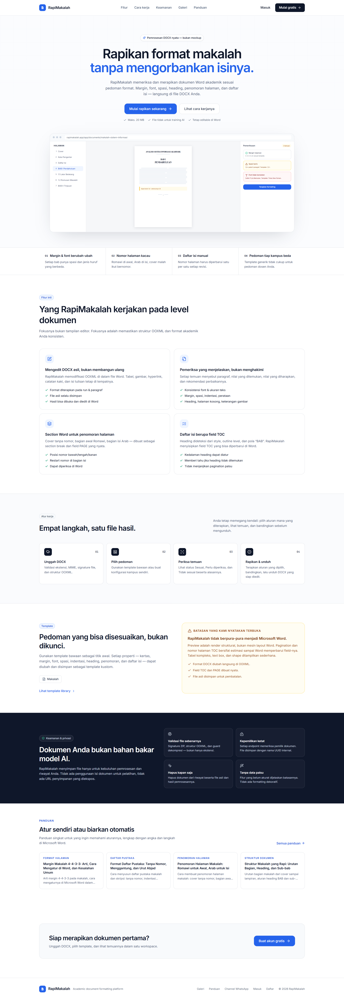

## 1.2 Tujuan dan Manfaat Program

Tujuan dan manfaat RapiMakalah meliputi:

1. Mempercepat perapian format dokumen akademik.
2. Membantu pengguna menemukan ketidaksesuaian format secara transparan melalui nilai yang ditemukan, nilai yang diharapkan, dan saran perbaikan.
3. Menyediakan template yang dapat disesuaikan dengan pedoman institusi.
4. Mempertahankan file asli sehingga hasil pemformatan dapat dibandingkan atau direset.
5. Menyediakan workspace menulis di browser dan ekspor draft ke DOCX.
6. Menyimpan dokumen, template, dan aktivitas pada akun pengguna.

## 1.3 Sasaran Pengguna

1. Mahasiswa yang menyusun makalah, laporan praktikum, proposal, laporan PKL, atau skripsi.
2. Asisten dosen, laboran, dan pembimbing yang membantu memeriksa dokumen.
3. Operator yang memasang, menjalankan, mencadangkan, dan memelihara aplikasi.
4. Administrator yang memantau penggunaan serta mengelola akun.

## 1.4 Fitur-Fitur Program

Fitur utama aplikasi adalah sebagai berikut.

| Kelompok | Fitur utama |
| --- | --- |
| Input dokumen | Unggah DOCX hingga batas ukuran yang dikonfigurasi atau buat dokumen dari teks/Markdown |
| Pemeriksaan | Analisis font, ukuran, spasi, indentasi, perataan, heading, margin, halaman kosong, dan caption |
| Pemformatan | Pengaturan halaman, margin, tipografi, heading, paragraf, tabel, penomoran, dan daftar isi |
| Pratinjau | Melihat struktur dokumen asli/hasil, outline, navigasi halaman, dan temuan |
| Cover | Data judul, jenis dokumen, mata kuliah, dosen, anggota dan NIM, logo, serta identitas institusi |
| Template | Menggunakan template Makalah, menduplikasi, membuat template kustom, dan mengatur konfigurasi |
| Galeri | Menerbitkan template kustom, mencari/filter, dan menyimpan salinan ke akun |
| Workspace Menulis | Menulis draft, heading, daftar, tabel, gambar, pemisah halaman, autosave, impor DOCX, dan ekspor DOCX |
| Akun | Registrasi/login email-password atau Google jika diaktifkan, profil, pengelolaan password, dan penghapusan akun |
| Riwayat | Mencari, memfilter, membuka, mengunduh ulang, dan menghapus dokumen |

## 1.5 Teknologi yang Digunakan

| Lapisan | Teknologi |
| --- | --- |
| Antarmuka web | React, Vite, React Router, Tailwind CSS |
| Backend API | Node.js, Express, Zod |
| Akun dan keamanan | JWT pada cookie httpOnly, bcrypt, pembatasan permintaan |
| Database | Prisma ORM; SQLite untuk lokal dan schema PostgreSQL opsional |
| DOCX | JSZip dan pemrosesan OOXML |
| Workspace Menulis | Tiptap/ProseMirror dan ekspor DOCX |
| Deployment | Express satu origin dengan reverse proxy atau tunnel opsional |

## 1.6 Batasan Program

1. Aplikasi memproses `.docx`; file `.doc`, PDF, dokumen rusak, atau dokumen terenkripsi tidak didukung.
2. Pratinjau bersifat struktural, bukan mesin tata letak Microsoft Word. Pagination dan nomor halaman dapat berbeda.
3. Daftar isi perlu diperbarui di Word untuk mendapatkan nomor halaman final.
4. Tabel kompleks, text box, dan shape dapat ditampilkan secara sederhana pada pratinjau.
5. Workspace Menulis belum memiliki seluruh kemampuan Microsoft Word, seperti komentar dan track changes.
6. Template bawaan bersifat baca-saja; pengguna dapat menduplikasinya untuk membuat template kustom.
7. Hasil akhir harus diperiksa kembali dan disesuaikan dengan pedoman resmi institusi.

# BAB II INSTALASI

## 2.1 Sources Program

Source code RapiMakalah tersusun dalam beberapa direktori utama.

| Direktori/berkas | Fungsi |
| --- | --- |
| `client/` | Antarmuka web React dan Vite |
| `client/src/pages/` | Halaman dan rute aplikasi |
| `client/src/components/` | Komponen antarmuka, editor, dan pratinjau |
| `server/` | Backend API dan layanan aplikasi |
| `server/src/docx/` | Pembacaan, pemformatan, perbaikan, dan pratinjau DOCX/OOXML |
| `server/src/routes/` | Endpoint API untuk akun, dokumen, template, dan fitur lain |
| `server/prisma/` | Schema database dan seed template |
| `server/scripts/` | Skrip pemeriksaan dan uji regresi |
| `deploy/` | Contoh konfigurasi deployment |
| `docs/` | Manual, panduan, dan catatan desain |
| `README.md` | Dokumentasi proyek dan referensi perubahan terkini |

Database lokal (`server/prisma/dev.db`), file pengguna (`server/storage/`), konfigurasi rahasia `.env`, dependency, hasil build, dan backup tidak disertakan sebagai source publik.

## 2.2 Kebutuhan Perangkat Keras dan Perangkat Lunak

### 2.2.1 Perangkat Keras

Komputer yang dapat menjalankan Node.js dan browser modern dapat digunakan untuk pengembangan. Besaran RAM dan ruang penyimpanan bergantung pada jumlah file serta pengguna. Operator produksi perlu menyediakan ruang yang cukup untuk database, file unggahan, dan backup.

### 2.2.2 Perangkat Lunak

| Perangkat lunak | Kebutuhan |
| --- | --- |
| Sistem operasi | Windows, macOS, atau Linux |
| Node.js | Versi 20 atau lebih baru |
| npm | Versi 10 atau lebih baru |
| Git | Opsional, untuk mengambil dan mengelola source code |
| Browser | Browser modern dengan dukungan JavaScript |
| Docker | Opsional, misalnya jika menggunakan PostgreSQL dari konfigurasi proyek |
| `cloudflared` | Opsional, hanya jika deployment menggunakan Cloudflare Tunnel |

## 2.3 Proses Instalasi Lokal

Langkah berikut ditujukan untuk clone baru dan database lokal kosong.

1. Buka terminal pada folder proyek.
2. Pasang dependency:

   ```powershell
   npm install
   npm run install:all
   ```

3. Salin contoh konfigurasi server:

   ```powershell
   Copy-Item server\.env.example server\.env
   ```

4. Atur `JWT_SECRET` dengan string acak minimal 32 karakter. Jangan membagikan file `.env`.
5. Siapkan schema dan template pada database lokal baru:

   ```powershell
   npm run db:setup
   ```

   Perintah ini menjalankan `prisma db push` dan seed template. Jangan arahkan perintah ke database yang berisi data tanpa backup terverifikasi serta peninjauan perubahan schema.
6. Jalankan aplikasi dengan perintah pada bagian 2.5.

Google Sign-In bersifat opsional. Untuk mengaktifkannya, isi `GOOGLE_CLIENT_ID` pada `server/.env` dan tambahkan origin frontend, umumnya `http://localhost:5173`, ke **Authorized JavaScript origins** pada Google Cloud Console.

## 2.4 Konfigurasi dan Database

Variabel yang umum diatur pada `server/.env` atau `server/.env.production`:

| Variabel | Fungsi |
| --- | --- |
| `PORT` | Port Express; umumnya 4000 untuk lokal |
| `CLIENT_ORIGIN` | Origin frontend yang diizinkan |
| `CANONICAL_URL` | URL publik untuk metadata situs |
| `JWT_SECRET` | Kunci sesi; produksi wajib memakai nilai acak minimal 32 karakter |
| `GOOGLE_CLIENT_ID` | OAuth Client ID opsional untuk Google Sign-In |
| `DATABASE_URL` | Lokasi SQLite atau URL PostgreSQL |
| `STORAGE_DIR` | Lokasi penyimpanan file pengguna |
| `MAX_UPLOAD_MB` | Batas ukuran unggahan, default 20 MB |
| `COOKIE_SECURE` | Aktifkan `true` jika layanan memakai HTTPS |
| `NODE_ENV` | Gunakan `production` pada server produksi |

SQLite merupakan database default untuk pengembangan lokal. Database berada pada `server/prisma/dev.db` dan file unggahan disimpan di `server/storage/`. PostgreSQL tersedia sebagai pilihan konfigurasi. Periksa `DATABASE_URL`, backup database dan storage, lalu tinjau schema sebelum menjalankan `db:push` pada database yang sudah berisi data.

## 2.5 Menjalankan Program

### 2.5.1 Mode Pengembangan

Jalankan frontend dan backend:

```powershell
npm run dev
```

Frontend Vite tersedia secara default pada `http://localhost:5173` dan API pada `http://localhost:4000`. Jika diperlukan, jalankan backend dan frontend secara terpisah menggunakan `npm --prefix server run dev` dan `npm --prefix client run dev`.

### 2.5.2 Build dan Mode Produksi

```powershell
npm run build
npm start
```

Build frontend disimpan di `client/dist`; Express menyajikan frontend dan API dari satu origin bila hasil build tersedia. Produksi wajib memakai HTTPS, `COOKIE_SECURE=true`, nilai `JWT_SECRET` yang kuat, serta database dan storage yang telah disiapkan.

### 2.5.3 Deployment dan Pemeriksaan

Operator dapat memakai reverse proxy atau contoh Cloudflare Tunnel pada folder `deploy/`. Isi hostname, kredensial, origin publik, dan environment pada mesin deployment, bukan di repository. Migrasi database tidak dijalankan otomatis.

Periksa kesehatan API melalui:

```text
https://<domain-anda>/api/health
```

Pastikan halaman utama dan endpoint kesehatan merespons dengan benar. Untuk menghentikan mode pengembangan, hentikan proses terminal; untuk deployment berbasis skrip, ikuti cara penghentian layanan yang digunakan operator.

# BAB III PENGGUNAAN PROGRAM

## 3.1 Membuka Aplikasi dan Membuat Akun

1. Buka URL RapiMakalah yang diberikan operator.
2. Pilih **Mulai gratis** untuk membuat akun dengan nama, email, dan password minimal 8 karakter.
3. Jika Google Sign-In sudah dikonfigurasi operator, pengguna juga dapat mendaftar atau masuk melalui Google.
4. Selesaikan proses autentikasi untuk masuk ke dashboard.

Akun lokal yang sudah ada tidak otomatis digabungkan dengan akun Google hanya karena memakai alamat email yang sama. Ikuti instruksi halaman login apabila email sudah terdaftar.

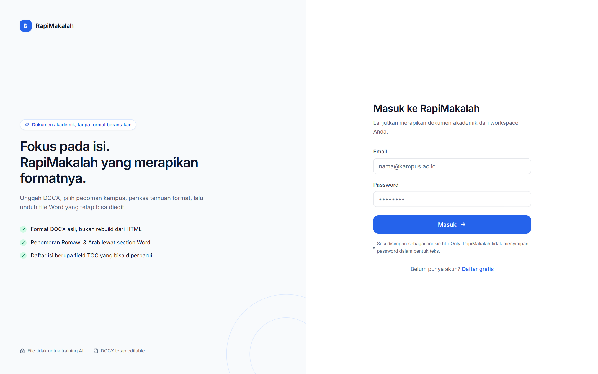

## 3.2 Dashboard dan Navigasi

Dashboard menampilkan ringkasan dokumen, skor format, dokumen terbaru, aktivitas, dan pintasan membuat dokumen. Menu utama mencakup Dashboard, Dokumen, Template, Galeri template, Pengaturan akun, dan menu administratif untuk akun yang memiliki peran admin.

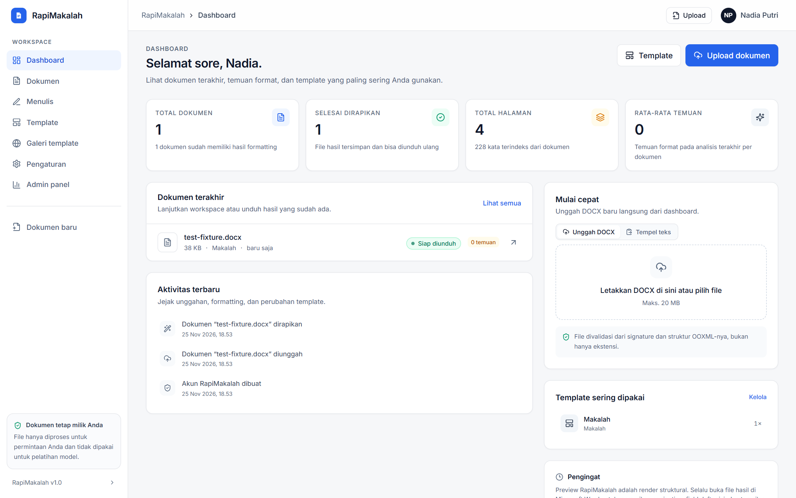

## 3.3 Membuat Dokumen

Pilih **Dokumen baru**, kemudian gunakan salah satu metode berikut:

1. **Unggah DOCX**: pilih atau seret file `.docx` ke area unggah. Batas default ukuran unggahan adalah 20 MB. Arsip dan struktur DOCX divalidasi sebelum diproses.
2. **Tulis teks**: tempel teks atau Markdown. `#` dapat digunakan untuk judul bab, `##` untuk subbab, dan blok `$...$` atau `$$...$$` untuk rumus sederhana.

Setelah proses selesai, dokumen akan dibuka pada workspace dan juga tersedia pada riwayat.

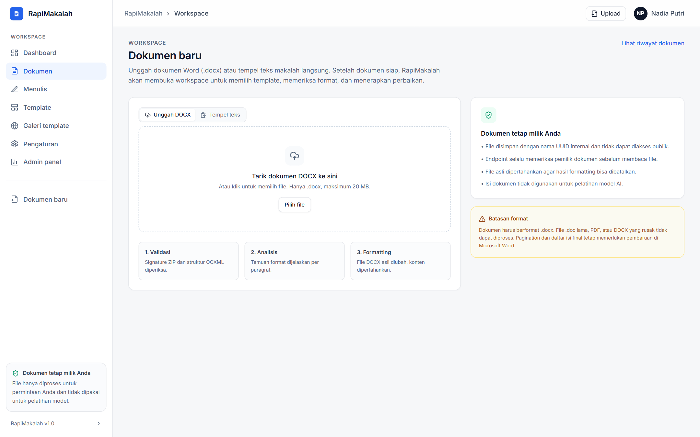

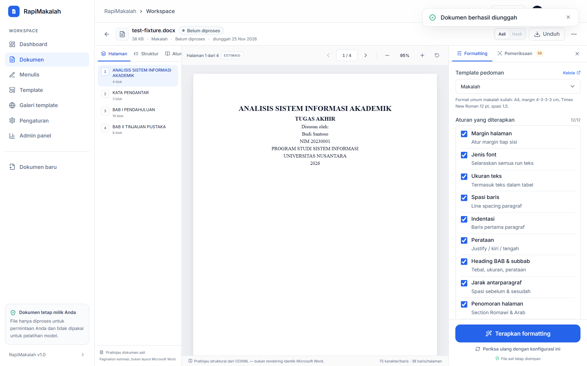

## 3.4 Memilih Template dan Mengisi Cover

Template Makalah tersedia sebagai acuan. Template kustom pengguna juga dapat dipilih. Pada panel cover, pengguna dapat mengisi jenis dokumen, judul, mata kuliah, dosen, anggota beserta NIM, logo, program studi, departemen, fakultas, institusi, kota, dan tahun.

Preview cover mengikuti perubahan isian. Untuk lebih dari satu anggota, nama dan NIM disusun agar tetap sejajar. Template bawaan bersifat baca-saja; duplikasikan terlebih dahulu jika akan membuat aturan sendiri.

## 3.5 Memeriksa Format

1. Buka tab **Periksa** pada workspace.
2. Klik **Jalankan pemeriksaan**.
3. Tinjau hasil yang dikelompokkan menjadi sesuai, perlu diperiksa, atau tidak sesuai.
4. Baca lokasi, nilai saat ini, nilai yang diharapkan, dan rekomendasi.
5. Pilih temuan untuk membantu menemukan bagian terkait di preview.

Pemeriksaan mencakup font, ukuran font, spasi, indentasi, perataan, heading, margin, halaman kosong, dan caption sesuai konfigurasi template.

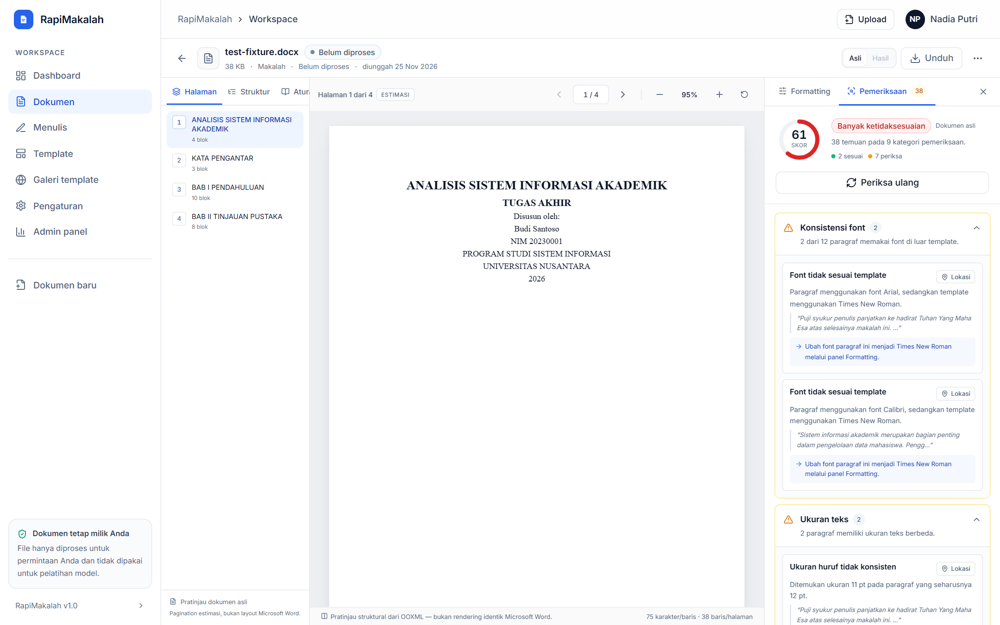

## 3.6 Menerapkan Formatting dan Meninjau Hasil

1. Pilih tab **Format**.
2. Pilih aturan yang ingin diterapkan, misalnya margin, font, spasi, indentasi, heading, penomoran halaman, atau daftar isi.
3. Klik **Terapkan formatting**.
4. Bandingkan tampilan **Asli** dan **Hasil**.
5. Unduh hasil sebagai DOCX dan periksa kembali di Microsoft Word.

File asli tetap disimpan. Tombol **Reset** menghapus hasil pemformatan dan mengembalikan dokumen ke versi asli tanpa menghapus dokumennya. Daftar isi Word dapat diperbarui dengan klik kanan lalu **Update Field**.

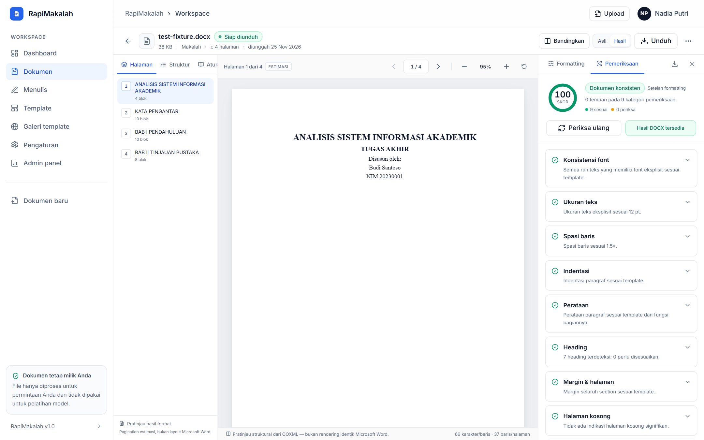

## 3.7 Riwayat Dokumen

Menu **Dokumen** menampilkan dokumen pengguna, status pemeriksaan, jumlah temuan, dan waktu pemrosesan. Pengguna dapat mencari, memfilter, membuka, mengunduh ulang, atau menghapus dokumen. Penghapusan dokumen berbeda dari reset: penghapusan membuang data dokumen dan file terkait.

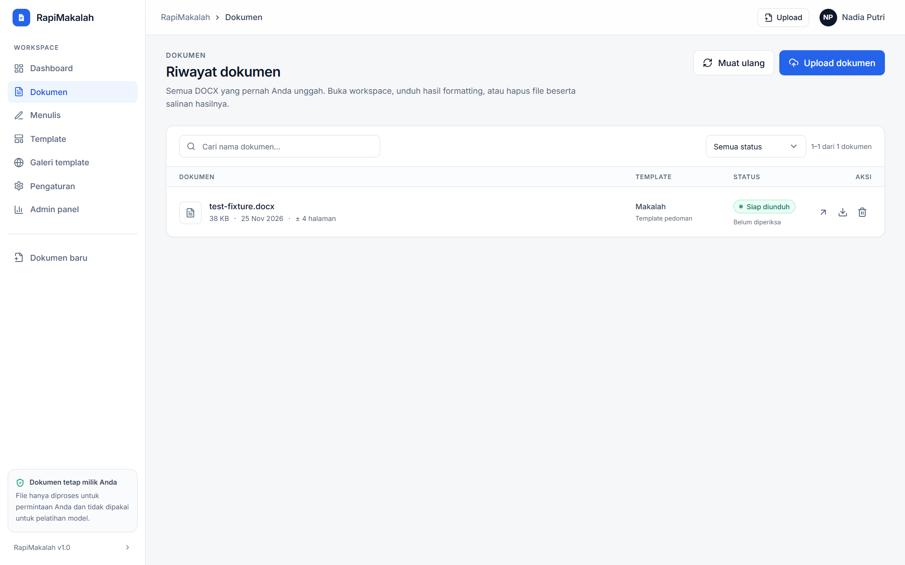

## 3.8 Mengelola Template dan Galeri

Pada menu **Template**, pengguna dapat menduplikasi template bawaan atau mengedit template kustom. Pengaturan mencakup ukuran kertas dan margin, tipografi, heading, penomoran halaman, daftar isi, daftar pustaka, caption, serta isian cover bawaan.

Template kustom dapat dibagikan melalui tautan, dicabut, atau diterbitkan ke **Galeri template**. Galeri publik dapat dicari dan difilter. Pengguna yang masuk dapat menyimpan salinan template ke akun; salinan tersebut berdiri sendiri dan tidak mengubah template penerbit.

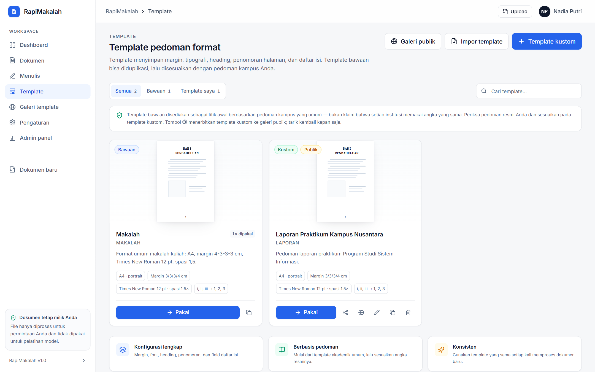

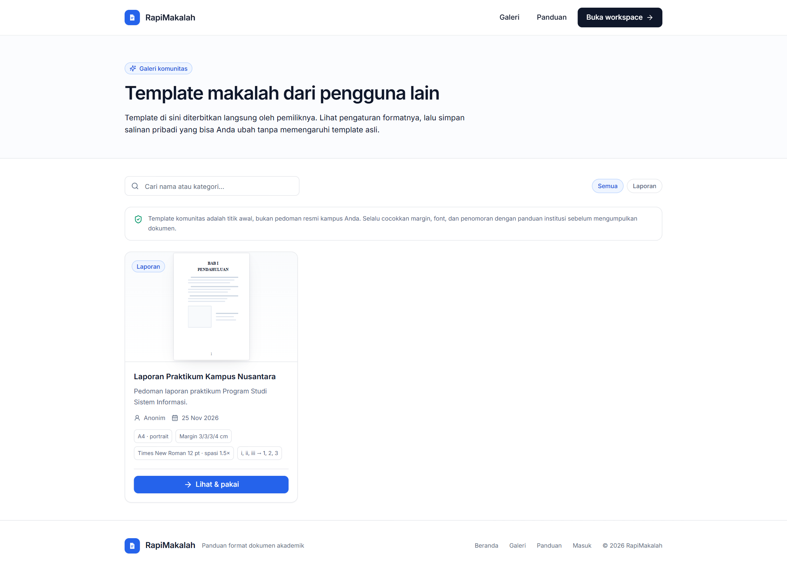

## 3.9 Workspace Menulis

Workspace **Menulis** digunakan untuk membuat draft dari browser. Fitur yang tersedia meliputi heading, format teks, perataan, daftar, undo/redo, autosave, pemulihan perubahan lokal, penggaris, tabel, gambar PNG/JPG, dan pemisah halaman. Draft tersimpan pada akun dan dapat diunduh sebagai DOCX dengan format dasar A4, Times New Roman 12 pt, spasi 1,5, margin kiri 4 cm, dan sisi lain 3 cm.

Pengguna juga dapat mengimpor DOCX sebagai draft baru. Impor mengambil teks, heading, tabel, dan gambar, tetapi tata halaman, header/footer, field daftar isi, dan fitur Word lanjutan dapat berubah atau tidak ikut terbawa. Ukuran gambar dan draft dibatasi aplikasi.

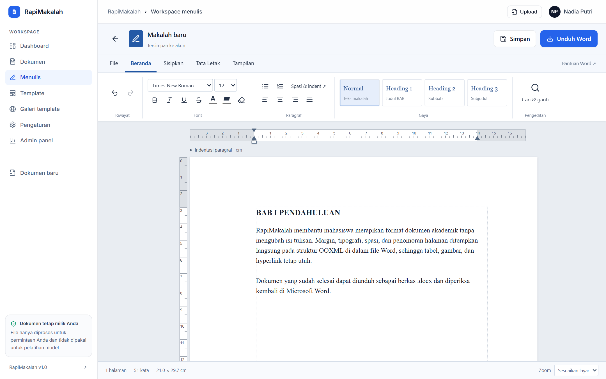

## 3.10 Pengaturan Akun dan Keamanan

Menu **Pengaturan akun** digunakan untuk mengubah nama, institusi, dan program studi serta mengelola password. Akun Google dapat menambahkan password lokal. Penghapusan akun memerlukan verifikasi sesuai metode akun dan menghapus dokumen serta template milik pengguna secara permanen.

Gunakan password yang kuat dan jangan membagikan cookie sesi atau kredensial. Operator harus menjaga `JWT_SECRET`, file `.env`, database, dan storage agar tidak dapat diakses publik. File DOCX dan hasilnya sebaiknya dibuka kembali di Microsoft Word untuk pemeriksaan akhir.

## 3.11 Fitur Administrator

Akun dengan peran admin dapat membuka panel admin untuk melihat statistik penggunaan dan mengelola akun sesuai hak akses yang tersedia. Pengguna pertama pada database kosong ditetapkan sebagai admin. Operasi administratif seperti penghapusan akun berdampak permanen dan harus dilakukan dengan cermat.

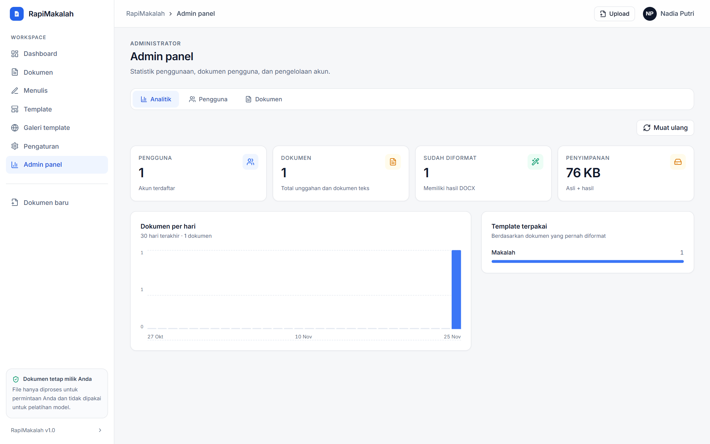

## 3.12 Bagian yang Belum Tersedia

### 3.12.1 Tangkapan Layar Penggunaan

Tangkapan layar penggunaan aplikasi ditampilkan pada Gambar 1 sampai Gambar 12. Setiap gambar diberi keterangan sesuai tahapan penggunaan.

### 3.12.2 Informasi Bantuan Operator

# DAFTAR PUSTAKA

1. RapiMakalah. (2026). *README proyek RapiMakalah*. Dokumentasi proyek, `README.md`.
2. RapiMakalah. (2026). *Panduan deployment RapiMakalah*. Dokumentasi proyek, `deploy/README.md`.
3. Microsoft Support. (t.t.). *Using the ruler in Word*. https://support.microsoft.com/en-gb/word/using-the-ruler-in-word
4. Node.js. (t.t.). *Node.js Documentation*. https://nodejs.org/docs/
5. React. (t.t.). *React Documentation*. https://react.dev/
6. Prisma. (t.t.). *Prisma Documentation*. https://www.prisma.io/docs

Catatan: URL deployment, identitas penyusun, daftar gambar, dan nomor halaman daftar tabel/isi perlu disesuaikan sebelum makalah dipublikasikan atau dicetak.
